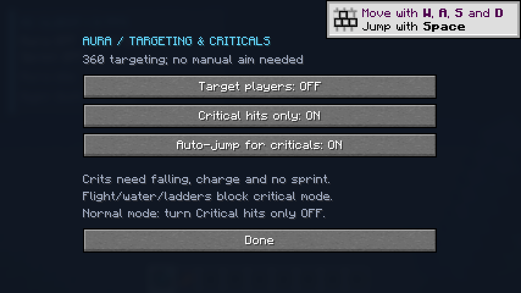
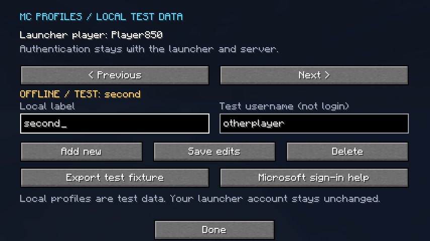

# MC Client — Fabric 1.21.11

Version 1.2.0 includes an **in-game local profile manager**. Click **MC Profiles** on the title screen, press **F8** in a world, or use its button in the Right Shift module menu. The optional [desktop manager](profile-manager/README.md) remains available separately.

Client-side Minecraft mod for Java 21, Fabric Loader 0.19.2+, and Fabric API 0.141.6+1.21.11.

## Features

- Right Shift opens the module menu; Escape closes it.
- R toggles Kill Aura: stable 360-degree targeting of visible hostile mobs, with player priority when player targeting is enabled. Teammates, invisible targets and invulnerable entities are excluded. Reach uses the nearest hitbox surface and is capped by the actual game interaction range. Block collision prevents attacks through walls.
- G toggles Flight. Move with WASD, ascend with Space, descend with Sneak. Flight changes local velocity; server authority can correct or reject movement.
- Auto Sprint, toggleable HUD with FPS and module status, adjustable attack range and flight speed.
- Settings persist in `config/mcclient.json`. Active combat/movement toggles reset when leaving a world. Rebind keys through Minecraft Controls.
- MC Profiles adds local test profiles with custom usernames, editable labels, previous/next selection, confirmed deletion, and JSON test-fixture export. These names never replace the active Minecraft session.

## Aura options

Open **Right Shift → Aura options**. **Critical hits only** and **Auto-jump for criticals** default to ON; existing player-targeting preferences are preserved. Enable **Target players** if desired. With a valid nearby target and a fully charged attack, the client stops sprinting, performs a normal jump when space permits, and attacks during descent. No manual camera aiming is required.

Critical-only mode waits rather than hitting while grounded, rising, sprinting, using items, in water/lava, on ladders, riding, gliding or flying. Disable Flight for critical combat. Low ceilings, sneaking, or disabling auto-jump require you to produce a valid falling window yourself. To retain ordinary full-charge ground attacks, turn **Critical hits only OFF**. The HUD reports whether Aura is charging, jumping, waiting or movement-blocked.

A local creative-world smoke check with critical-only/auto-jump enabled confirmed that a tagged zombie behind the player remained at 20 health behind a stone wall, then was killed after removing the wall without turning the camera. Individual server critical outcomes were not instrumented.



Attack cooldown, server hit validation, target damage immunity and critical-hit rules still apply. The mod does not fabricate critical packets, exceed legitimate reach, guarantee every hit is critical on a server, or provide an anti-cheat bypass.

## In-game profiles

Open MC Profiles from the title screen or with F8 in a world. Enter a label and a 3–16 character test username, then choose **Add new**. **Previous/Next** switches the selected local record. Edit either field and choose **Save edits**; **Delete** asks for confirmation. **Export test fixture** writes data under `config/mcprofiles/test-fixtures/` for your own local development tools. It does not launch a game or authorize a connection.

All stored profiles are clearly labeled **OFFLINE / TEST**. The current launcher player is shown separately. The mod cannot establish authentication merely from a launcher-supplied username and does not claim a saved profile is authenticated. Test profiles do not change your name, UUID, access token, Minecraft session, or server identity.

**Microsoft sign-in help** opens a confirmation before taking you to the official Minecraft login website. To switch actual Minecraft accounts, close the game, sign in with the legitimate account through the official launcher, and relaunch. This mod deliberately does not implement an in-game account/session switcher or reuse TLauncher sessions. It asks for no passwords and stores no credentials. The desktop manager's approved-app-ID OAuth integration is not embedded in this mod.

Local metadata is stored in `config/mcprofiles/profiles.json` using atomic replacement and owner-only permissions on macOS/Linux. Corrupt files are preserved and reported. Selected profiles persist across restarts. The separate desktop manager uses its own settings and does not automatically share profiles with the mod.

## Build and run

```sh
./gradlew build
./gradlew runClient
```

Install `build/libs/mcclient-1.3.0+mc1.21.11.jar` (not the sources jar) into a Minecraft 1.21.11 Fabric instance's `mods` folder alongside Fabric API. Use your normal authenticated launcher to join online servers. This project does not modify authentication or provide anti-cheat bypasses. Use modules only where permitted; server compatibility is not guaranteed.

## Validation

Compile with `./gradlew build`. Sixteen JVM tests cover profile storage, critical timing conditions, and hitbox geometry (including targets behind the player and outside reach). No automated in-game tests are included. In a disposable single-player world, verify the menu and key rebindings, toggle the HUD, change and reload settings, spawn a hostile mob and check cooldown attacks, verify Flight directions and disabling, and reconnect to confirm active modules reset. For profiles, verify title-screen access, F8, edit fields, previous/next, deletion confirmation, and export; confirm your launcher player name stays unchanged. Multiplayer enforcement and graphical behavior require testing in a running game; a successful build alone does not verify these.

Local runtime checks passed for title-screen access, add, rename, switch, export, cancel/confirm deletion, and reopening the screen with persisted selection. The launcher player remained unchanged. Microsoft account authentication and multiplayer were not tested.



## Install on your computer

Close Minecraft first. After building, run `python tools/install.py` on the computer that has Minecraft installed. For Prism/Modrinth/CurseForge or another custom instance, use `python tools/install.py --mods-dir "/path/to/instance/mods"`. To install a downloaded Actions artifact, unzip it and pass `--jar "/path/to/mcclient-1.3.0+mc1.21.11.jar"`. The installer copies the JAR, preserves the build output, and refuses to overwrite existing versions. It does not install Fabric Loader or Fabric API.

GitHub Actions builds uploaded commits and stores the mod under the `mcclient-fabric-1.21.11` artifact on a successful workflow run.

### macOS / Apple Silicon / TLauncher

The mod JAR is platform independent. Select a **Minecraft 1.21.11 Fabric** profile and Java 21 appropriate for Apple Silicon in your launcher. A vanilla or Forge profile cannot load this mod. Check TLauncher's configured game directory; the default macOS location is `~/Library/Application Support/minecraft`. Copy the built JAR and Fabric API into that directory's `mods` folder, or run:

```sh
python3 tools/install.py --mods-dir "$HOME/Library/Application Support/minecraft/mods"
```

For a custom TLauncher game directory, replace that path with the actual directory's `mods` subfolder. Installation must run on your Mac; the cloud development workspace cannot access its filesystem. Compatibility with `play.blockfun.gg` is unverified. No server-specific anti-cheat bypass is included.

A prebuilt JAR from the verified compile is included at `releases/mcclient-1.3.0+mc1.21.11.jar` with its SHA-256 in `releases/SHA256SUMS`. The profile UI was exercised in a local Minecraft development runtime with Loader 0.19.2; multiplayer behavior remains untested. To install that file on macOS from a downloaded repository checkout, run:

```sh
python3 tools/install.py --jar releases/mcclient-1.3.0+mc1.21.11.jar --mods-dir "$HOME/Library/Application Support/minecraft/mods"
```

## Upgrading from the 1.21.1 client

Remove `mcclient-1.0.0.jar` from your mods folder before installing this release. Use Minecraft **1.21.11**, Fabric Loader **0.19.2+**, and Fabric API **0.141.6+1.21.11**. The previous 1.21.1 build is incompatible with 1.21.11. Existing `config/mcclient.json` settings remain compatible.

Loader compatibility: release 1.3.0 targets Fabric Loader 0.19.2+. Remove earlier MC Client JARs (including 1.2.0) before installing it.
